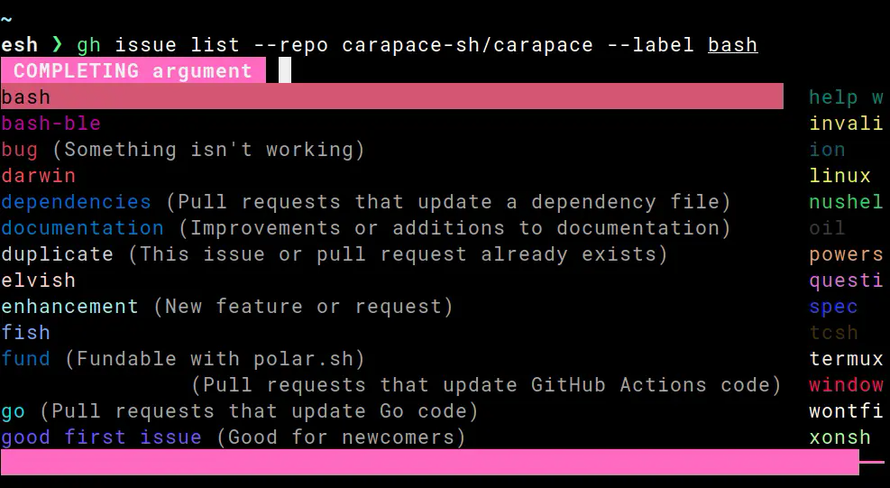

<h1 id="carapace"><a class="header" href="#carapace">Carapace</a> </h1>

A multi-shell completion **[library](https://github.com/carapace-sh/carapace)** and **[binary](https://github.com/carapace-sh/carapace-bin)**.

<h1><strong><u><a href="https://pixi.carapace.sh">Read</a></u>,</strong></h1>

<h1><strong><u><a href="https://carapace-sh.github.io/carapace-bin/install.html">Install</a></u> and <u><a href="https://carapace-sh.github.io/carapace-bin/setup.html">Setup</a></u>.</strong></h1>

## Vibrant

### Highlight in different **[Styles](https://carapace-sh.github.io/carapace/carapace/action/style.html)**.

### Group by **[Tags](https://carapace-sh.github.io/carapace/carapace/action/tag.html)**.

### Give feedback with **[Messages](https://carapace-sh.github.io/carapace/carapace/defaultActions/actionMessage.html)**.

## Fast

### **[Export](https://carapace-sh.github.io/carapace/carapace/export.html)** in milliseconds.

### **[Cache](https://carapace-sh.github.io/carapace/carapace/action/cache.html)** slow completions.

### Invoke concurrent **[Batch](https://carapace-sh.github.io/carapace/carapace/batch.html)**.

## Complex

### Add **[Plugins](https://carapace-sh.github.io/carapace/carapace/gen/preRun.html)** and change **[Workdir](https://carapace-sh.github.io/carapace/carapace/gen/preInvoke.html)**.

### **[Embed](https://carapace-sh.github.io/carapace-bin/spec/embed.html)** continuously.

### Complete as **[MultiParts](https://carapace-sh.github.io/carapace/carapace/defaultActions/actionMultiParts.html)**.

## Versatile

### Write custom **[Specs](https://carapace-sh.github.io/carapace-bin/spec.html)**.

### Leverage existing **[Macros](https://carapace-sh.github.io/carapace-bin/spec/macros.html)**.

### **[Bridge](https://carapace-sh.github.io/carapace-bin/spec/bridge.html)** other frameworks.

